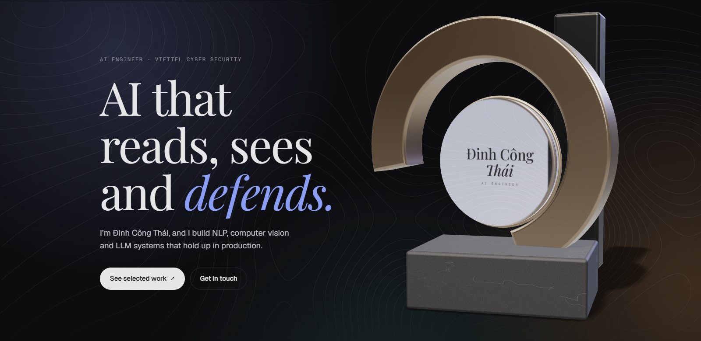
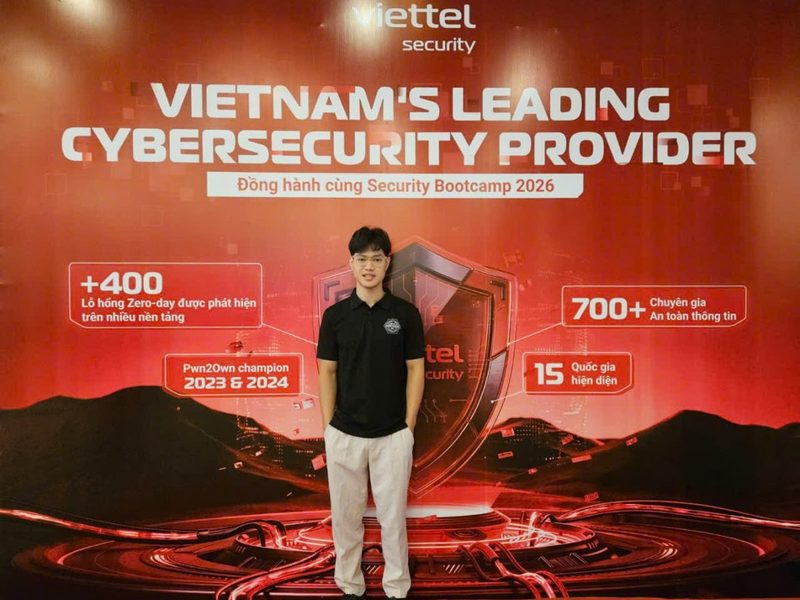
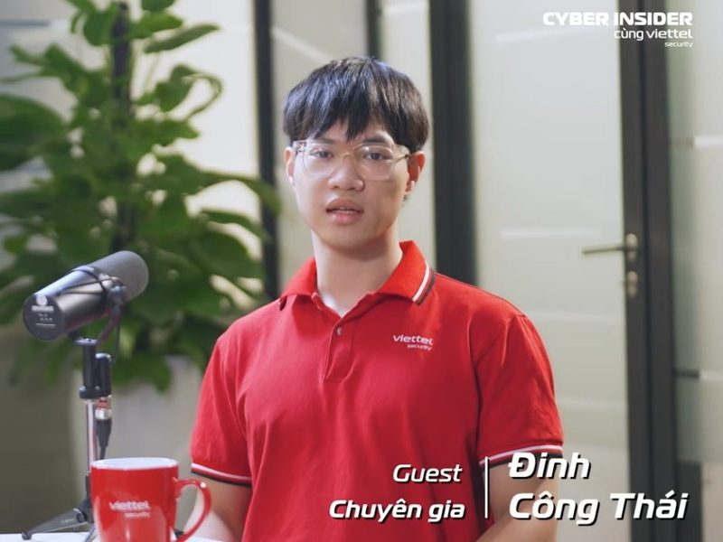
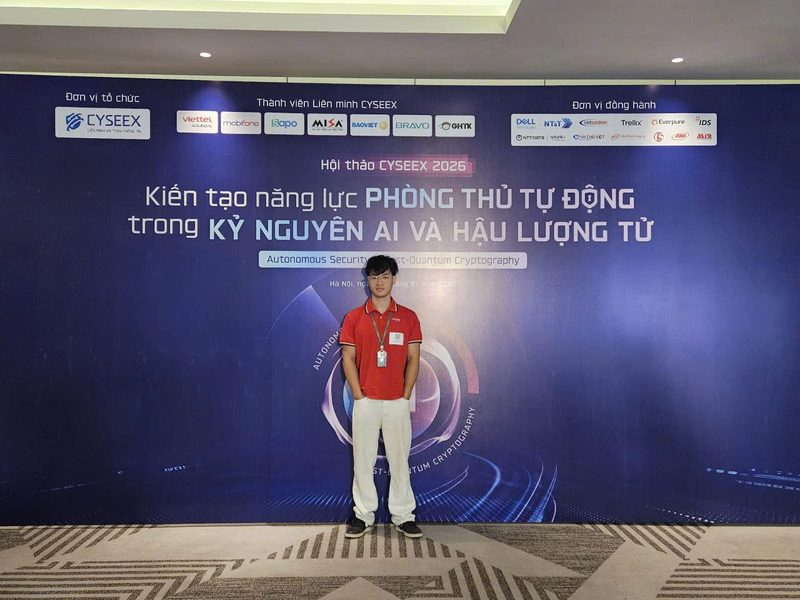
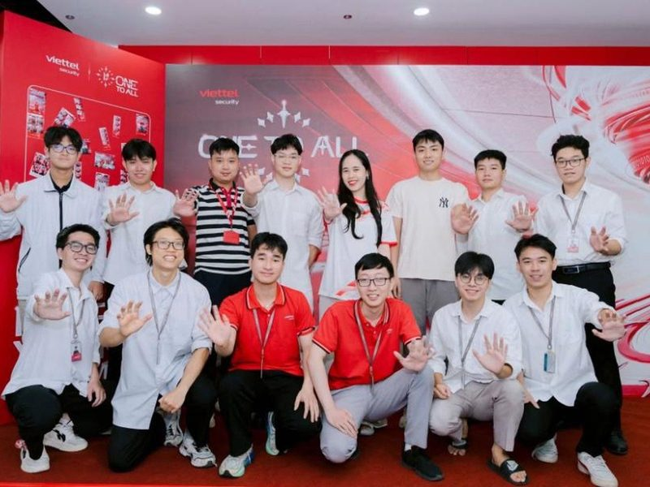

<h1 align="center">Hi 👋, I'm Đinh Công Thái</h1>

  

  
  
  

---

## 🧠 About Me

- 🛡️ **Junior AI Engineer at [Viettel Cyber Security](https://viettelcybersecurity.com/)** (since 2025): LLMs for cybersecurity, scam detection, training data for agents
- 🧑‍🔬 **Research Assistant at [AI4LIFE Research Center](https://ai4life.hust.edu.vn/)**, HUST (since 11/2024)
- 🎓 **B.Eng. Computer Science (AI)**, Hanoi University of Science and Technology, 2022–2026, graduated with a *Very Good* degree
- 🥈 Second Prize, Vietnam National Physics Olympiad 2022

---

## 📄 Research

| | Paper | Venue | Status |
|---|---|---|---|
| 🎙️ | **SAID: Speaker-Invariant Adversarial Identity Disentanglement for Robust Low-Resource Speaker Verification** | CSoNet 2026, Ho Chi Minh City | ✅ Accepted |
| 📞 | **ViScam**: a dataset on Vietnamese scams, and the paper that introduces it | EACL 2027 (CORE A) | 📝 Under review |

**Open learning materials** I wrote and keep updating:

- 📘 **[Encyclopedia of NLP – Theory & Practice](https://github.com/ciTy1504/intro-to-nlp/blob/main/NLP_all.pdf)**: linguistics, statistical models, neural nets, Transformers, LLMs, alignment, benchmarking, plus data collection, training, deployment and MLOps.
- 📗 **[Encyclopedia of CV – Theory & Practice](https://github.com/ciTy1504/intro-to-cv/blob/main/Tex/main.pdf)**: CNNs, ViTs, alignment, benchmarking, plus the same end-to-end practical guides.

---

## 🎤 Talks & Community · 2026

<table>
  <tr>
    <td width="50%" valign="top">
       
      <b>🎤 Speaker – Security Bootcamp 2026</b> 
      Talk 18 · Agentic Security · Buôn Ma Thuột, Sep 2026
    </td>
    <td width="50%" valign="top">
       
      <b>🎧 Guest – <a href="https://www.youtube.com/watch?v=86HbU_pguAk&t=172s">Cyber Insider #02</a></b> 
      Bringing AI into security monitoring and cutting SOC alert noise
    </td>
  </tr>
  <tr>
    <td width="50%" valign="top">
       
      <b>🛡️ <a href="https://www.cyseex.vn/hoi-thao-2026/">CYSEEX 2026</a></b> 
      Autonomous defence in the AI & post-quantum era · Hà Nội, Oct 2026
    </td>
    <td width="50%" valign="top">
       
      <b>👥 Viettel Cyber Security – AI Lab</b> 
      The team, 2026
    </td>
  </tr>
</table>

---

## 🚀 Featured Work

_Most of this was built for industry partners under NDA, so only the summaries are public. Happy to walk through the architecture in an interview._

### 🛡️ Viettel Cyber Security
- **ViScam – Vietnamese scam dataset & paper** · building the dataset and writing the paper (EACL 2027 submission)
- **Scam call & social-media fraud detection** · NLP content analysis plus behavioural patterns to flag scams in real time
- **LLM fine-tuning for security** · owning the training data: continued pre-training (CPT) corpora, long-context data and optimised agent trajectories

**Tech:** LLMs, CPT, Agents, NLP, Voice/Text classification, ML pipelines, FastAPI

### ⚖️ Legal & Banking AI (AI4LIFE × industry partners)
| Project | Partner | Highlights |
|---|---|---|
| 🏛️ Draft-law advisory chatbot | UBND Thanh Hóa | RAG + multi-label classification finds cited *and* uncited relevant laws, with fully referenced advice |
| 📄 Version-aware legal knowledge base | Vietcombank | MongoDB + Neo4j, keeps the original and the currently effective text of every clause |
| 🧩 Metadata extraction & data completion | Vietcombank | Extracts relationships between laws and fills missing fields in internal datasets |
| 💬 Legal & compliance chatbot | Vietcombank | Version-aware RAG, always answers from the regulation in force |
| 🏗️ Text2SQL with context engineering | Vietcombank | Adaptive prompts and query decomposition over very large databases |
| 📊 Data-analytics agent | MB Bank | Tool-using LLM: retrieves, computes trends with Pandas, answers with charts |

### 🎥 Media & Security AI
| Project | Partner | Result |
|---|---|---|
| 📝 Real-time toxic comment moderation | VNPT-Media | **F1 0.9892** in production (rules → PhoBERT → LLM cascade) |
| 📹 Live TV content moderation | VNPT-Media | YOLOv12 + OCR + tracking at **25 fps**, mAP above **70%** |
| 🌐 Malicious domain detection | SCS | **99.24% accuracy**, deep model with an XGBoost fail-safe |

### 🌟 Personal
- 🤖 **[AI-powered language learning app](https://engchi-app.web.app/)** · English/Chinese, 8 LLM-powered modules including a conversational tutor · [demo on TikTok](https://www.tiktok.com/@koong_t/video/7694247700233162004)
- 🌐 **[This portfolio](https://portfolio-64c65.web.app)** · hand-written HTML/CSS/JS with GSAP, Lenis and a three.js hero

---

## 🧰 Tech Stack

**AI / ML**

  

**Backend, Web & Deployment**

  

**Data & Tools**

  

Also: Hugging Face Transformers, RAG, vector DBs (FAISS, Milvus), Neo4j, YOLOv12, PhoBERT, Weights & Biases

---

## 📊 GitHub Stats

  
  

---

  <a href="https://portfolio-64c65.web.app"><b>portfolio-64c65.web.app</b></a> ·
  <a href="https://www.linkedin.com/in/thai-dinh-cong/">LinkedIn</a> ·
  <a href="mailto:bong1552004@gmail.com">bong1552004@gmail.com</a>

  

